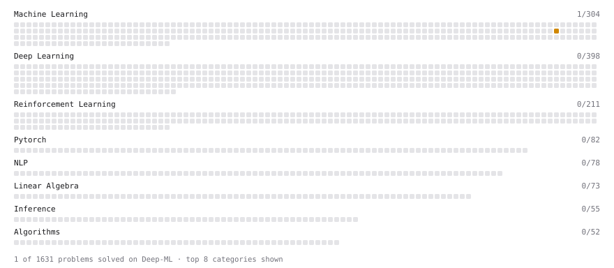

# Deep-ML

My machine learning practice from [Deep-ML](https://www.deep-ml.com). Every solution here was written by hand.

**10** solved · 10 problems · 0 labs · 0 math

[**Browse the interactive portfolio**](https://RijuPaul46.github.io/deep-ml/) to replay this filling in over time.

## Problems

| | Difficulty | Solved | |
| --- | --- | --- | --- |
| [Implement Early Stopping Based on Validation Loss](https://www.deep-ml.com/problems/135) | easy | 2026-10-25 | [solution](problems/0135-implement-early-stopping-based-on-validation-loss) |
| [Bernoulli Naive Bayes Classifier](https://www.deep-ml.com/problems/140) | medium | 2026-10-29 | [solution](problems/0140-bernoulli-naive-bayes-classifier) |
| [Bias-Variance Decomposition from Bootstrap](https://www.deep-ml.com/problems/804) | medium | 2026-10-25 | [solution](problems/0804-bias-variance-decomposition-from-bootstrap) |
| [Find the Best Gini-Based Split for a Binary Decision Tree](https://www.deep-ml.com/problems/138) | medium | 2026-10-25 | [solution](problems/0138-find-the-best-gini-based-split-for-a-binary-decision-tree) |
| [Gaussian Naive Bayes Classifier](https://www.deep-ml.com/problems/261) | medium | 2026-10-29 | [solution](problems/0261-gaussian-naive-bayes-classifier) |
| [Generate Sorted Polynomial Features](https://www.deep-ml.com/problems/32) | medium | 2026-10-22 | [solution](problems/0032-generate-sorted-polynomial-features) |
| [Implement K-Nearest Neighbors](https://www.deep-ml.com/problems/173) | medium | 2026-10-26 | [solution](problems/0173-implement-k-nearest-neighbors) |
| [Learning Curve Generator for Bias-Variance Diagnosis](https://www.deep-ml.com/problems/800) | medium | 2026-10-24 | [solution](problems/0800-learning-curve-generator-for-bias-variance-diagnosis) |
| [Polynomial Regression Fit](https://www.deep-ml.com/problems/801) | medium | 2026-10-22 | [solution](problems/0801-polynomial-regression-fit) |
| [Decision Tree Learning](https://www.deep-ml.com/problems/20) | hard | 2026-10-26 | [solution](problems/0020-decision-tree-learning) |

---

_This file is regenerated by Deep-ML on every push._
